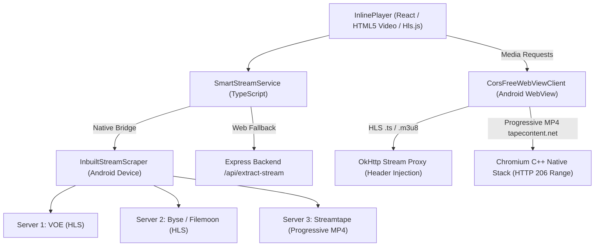

# MAXPLAY ADVANCED STREAMING & MEDIA SYSTEM ARCHITECTURE SPECIFICATION
> **Document Purpose:** Complete architectural blueprint and technical instruction set for AI agents to replicate, upgrade, and maintain the MaxPlay triple-server streaming pipeline and media engine without regressions.
> **Target Audience:** Autonomous AI coding agents, senior Android/Kotlin engineers, and full-stack video streaming architects.

---

## 1. High-Level System Architecture

MaxPlay operates as a **hybrid high-performance streaming ecosystem**:
1. **Frontend Layer:** React 18 + TypeScript + Vite bundled as local offline assets inside the APK (`android-kotlin/app/src/main/assets/webapp/`).
2. **Native Android Container (Kotlin):** A custom Chromium `WebView` controlled by [`CorsFreeWebViewClient.kt`](file:///C:/Users/LeNoVo/.gemini/antigravity/scratch/MaxPlay/android-kotlin/app/src/main/java/com/maxplay/app/CorsFreeWebViewClient.kt).
3. **On-Device Native Scraper Bridge:** [`InbuiltStreamScraper.kt`](file:///C:/Users/LeNoVo/.gemini/antigravity/scratch/MaxPlay/android-kotlin/app/src/main/java/com/maxplay/app/InbuiltStreamScraper.kt) & [`StreamtapeExtractor.kt`](file:///C:/Users/LeNoVo/.gemini/antigravity/scratch/MaxPlay/android-kotlin/app/src/main/java/com/maxplay/app/StreamtapeExtractor.kt) providing zero-CORS, device IP-bound stream extraction.
4. **Backend Server Layer:** Node.js + Express ([`server.ts`](file:///C:/Users/LeNoVo/.gemini/antigravity/scratch/MaxPlay/server.ts)) for browser fallback and cloud-side stream extraction.



---

## 2. Server 1: VOE (HLS Adaptive Bitrate)

### 2.1 Provider Details
- **CDN / Hosters:** `voe.sx`, `delivery-node-*.voe-network.net`, mirrors (`cloudwindow-route`, `fraudclatterflyingcar.com`, `turtledoveconsequent.com`).
- **Media Format:** HLS (`.m3u8` master playlist, variants `index-v1-a1.m3u8`, `index-v1-a2.m3u8`, `.ts` / `.m4s` transport stream segments).
- **Player Mechanism:** `Hls.js` with Media Source Extensions (MSE).

### 2.2 Extraction Logic (Native & Server)
VOE embeds the stream inside watch page `<script>` tags using either a direct JSON assignment or base64 encoded strings:
```regex
(?:'hls'|hls|'file'|file)\s*:\s*['"](https?://[^'"]+?\.m3u8[^'"]*?)['"]
```
Or Base64 encoded payload inside `window.atob(...)`:
```typescript
const b64Match = html.match(/window\.atob\s*\(\s*['"]([A-Za-z0-9+/=]{20,})['"]\s*\)/);
if (b64Match) {
  const decoded = Buffer.from(b64Match[1], 'base64').toString('utf-8');
  // extract .m3u8 from decoded string
}
```

### 2.3 Android Interception & Handling
- **Referer & Origin Injection:** Intercepted requests to VOE hostnames require:
  - `Referer: https://voe.sx/` (or current embed domain).
  - `Origin: https://voe.sx`.
- **Dual-Audio Master Playlist Sanitization:** VOE dual-audio manifests often set `#EXT-X-MEDIA:TYPE=AUDIO` `DEFAULT=NO` for both streams or misalign variants, leading to audio desync.
  [`CorsFreeWebViewClient.kt`](file:///C:/Users/LeNoVo/.gemini/antigravity/scratch/MaxPlay/android-kotlin/app/src/main/java/com/maxplay/app/CorsFreeWebViewClient.kt) filters redundant audio media tags and forces `DEFAULT=YES` on the primary variant.
- **Segment MIME Rewriting:** Segment URLs ending in disguised extensions (`.jpg`, `.png`, `.html`) must be rewritten to `Content-Type: video/mp2t`.

---

## 3. Server 2: Byse / Filemoon (Encrypted Packed HLS)

### 3.1 Provider Details
- **CDN / Hosters:** `filemoon.sx`, `byseraguci.com`, `bysedikamoum.com`, `sprintcdn.com`, `f16px.com`, `1azayf9w.com`, `8mhlloqo.com`.
- **Media Format:** Packed HLS (`.m3u8` playlists and disguised `.ts` / `.jpg` chunk segments on `sprintcdn.com`).
- **Player Mechanism:** `Hls.js` MSE player.

### 3.2 Extraction Logic (Dean Edwards Unpacker)
Byse/Filemoon encrypts source links inside `eval(function(p,a,c,k,e,d)...)` blocks. The extractor unpacks this using base-N radix dictionary substitution:
```typescript
function unpackDeanEdwards(packedJs: string): string {
  const match = packedJs.match(/eval\(function\(p,a,c,k,e,[rd]\)\s*\{[\s\S]*?\}\s*\(([\s\S]*?)\)\s*\)/);
  if (!match) return "";
  // Unpack dictionary using base36/base62 token lookup
  // Resulting payload contains: { sources: [{ file: "https://.../master.m3u8" }] }
}
```

### 3.3 Critical Requirements & Fixes
1. **Dynamic Host Referer Registration:**
   `sprintcdn.com` strictly blocks requests (HTTP 403 Forbidden) if the `Referer` does not match the embed source (`https://byseraguci.com/` or `https://filemoon.sx/`).
   - Every time Byse extracts a stream, [`CorsFreeWebViewClient.registerStreamReferer(targetUrl, embedReferer)`](file:///C:/Users/LeNoVo/.gemini/antigravity/scratch/MaxPlay/android-kotlin/app/src/main/java/com/maxplay/app/CorsFreeWebViewClient.kt) is invoked.
2. **Disguised Chunk Normalization:**
   Chunks ending in `.jpg` or `.png` served by `sprintcdn` must be intercepted and served with `Content-Type: video/mp2t`.
3. **Never Strip Parent Path for Segments:**
   VOE and Filemoon `.ts` segments reside in parent folders such as `...,.urlset/seg-1-v1-a1.ts`. Do not mistake `urlset` for a playlist.

---

## 4. Server 3: Streamtape (Progressive MP4)

### 4.1 Provider Details
- **CDN / Hosters:** `streamtape.com`, `streamta.pe`, `strtape.tech`, `strcloud.link`, `tapecontent.net`.
- **Media Format:** Progressive MP4 / MKV video container (NOT HLS, direct `<video src="...">`).
- **Player Mechanism:** HTML5 native `<video>` element with HTTP 206 Partial Content byte ranges.

### 4.2 The Fake-Token Trap & Reverse Evaluator
Streamtape attempts to break automated scrapers by injecting **fake static spans** with decoy links (`getElementById('robotlink').innerHTML = '...'`) early in the HTML.
**Solution:**
The extractor scans ALL occurrences of:
```regex
getElementById\s*\(\s*['"](?:ideoooolink|captchalink|norobotlink|robotlink|ideoolink|botlink)['"]\s*\)\s*\.innerHTML\s*=\s*([^;]+);
```
And evaluates from **LAST to FIRST** (`reversed()`):
```kotlin
for (idx in expressions.indices.reversed()) {
    val evaluated = evaluateStreamtapeJsExpr(expressions[idx])
    if (evaluated.contains("get_video?", ignoreCase = true) &&
        evaluated.contains("token=", ignoreCase = true)
    ) {
        return normalizeExtractedDirectUrl(evaluated)
    }
}
```

### 4.3 AST Substring & Concatenation Evaluator
Streamtape constructs the final URL using obfuscated concatenation and substring slicing:
```javascript
'//streamta.p' + ('xcde/get_video?id=0ZALX4PreGUbdK6&expires=...&token=...').substring(1).substring(2)
```
[`StreamtapeExtractor.kt`](file:///C:/Users/LeNoVo/.gemini/antigravity/scratch/MaxPlay/android-kotlin/app/src/main/java/com/maxplay/app/StreamtapeExtractor.kt) implements a safe token parser that resolves string literals, chained `.substring(start, end)`, and `.slice(...)` without executing untrusted JS on the UI thread.

### 4.4 ISP Censorship Bypass (India & Southeast Asia)
- In India, `streamtape.com` domain is DNS-blocked by major ISPs (Jio, Airtel).
- **Rule:** The extractor must automatically resolve watch URLs and `get_video` endpoints through unblocked mirrors:
  - `https://streamta.pe/v/{id}`
  - `https://strcloud.link/v/{id}`
  - `https://strtape.tech/v/{id}`
- If `normalizeExtractedDirectUrl` receives a relative `/get_video`, it must prepend `https://streamta.pe` instead of `https://streamtape.com`.

### 4.5 The Fatal 15-Second Buffering Bug & Solution
#### The Problem:
`tapecontent.net` was previously caught by `isKnownStreamCdnHost()` and proxied through `proxyExternalUrlWithOkHttp()`.
Returning a Java `InputStream` via `WebResourceResponse` to an HTML5 `<video src="...">` element **breaks Chromium's Range seeking**. Progressive MP4 files store the `moov` index atom at the tail of the file. Chromium cannot jump to the tail via a sequential OkHttp stream, causing it to stall for 12–15 seconds buffering sequentially before throwing:
```
MEDIA_ERR_SRC_NOT_SUPPORTED (Code 4)
"Failed to load video: Format Not Supported / URL Expired"
```

#### The Architectural Fix:
1. **Pass-Through Direct Media (Zero Interception):**
   `tapecontent.net` already sends:
   - `Access-Control-Allow-Origin: *`
   - `Accept-Ranges: bytes`
   - `HTTP/1.1 206 Partial Content`
   In [`CorsFreeWebViewClient.kt`](file:///C:/Users/LeNoVo/.gemini/antigravity/scratch/MaxPlay/android-kotlin/app/src/main/java/com/maxplay/app/CorsFreeWebViewClient.kt), direct media requests MUST return `null`:
   ```kotlin
   val isDirectProgressiveMedia =
       lower.contains("/get_video") ||
           host.contains("tapecontent") ||
           path.endsWith(".mp4") ||
           path.endsWith(".mkv") ||
           path.endsWith(".webm")

   if (isDirectProgressiveMedia && !lower.contains(".m3u8") && !path.endsWith(".ts")) {
       return null // Chromium C++ engine handles natively
   }
   ```
2. **HTTP 302 Native Redirect on `/api/stream-proxy`:**
   If the WebApp requests `/api/stream-proxy?url=...` with a `tapecontent` or `/get_video` target:
   ```kotlin
   if (lowerTarget.contains("tapecontent") || lowerTarget.contains("/get_video")) {
       val redirectHeaders = mapOf(
           "Location" to targetUrl,
           "Access-Control-Allow-Origin" to "*"
       )
       return WebResourceResponse("text/plain", "UTF-8", 302, "Found", redirectHeaders, ByteArrayInputStream(ByteArray(0)))
   }
   ```
3. **MIME Type Enforcement (`video/mp4`):**
   Android WebView Chromium DOES NOT support `video/x-matroska`. Even if the file is named `.mkv`, the extractor and proxy must strictly declare `Content-Type: video/mp4`.

---

## 5. WebView Interception Rules Matrix

| Target Host / Pattern | Stream Type | Action in `CorsFreeWebViewClient` | Headers Injected |
| :--- | :--- | :--- | :--- |
| `*.tapecontent.net/*` | Progressive MP4 | **BYPASS (`return null`)** | None (Native C++ HTTP 206) |
| `*/get_video?*` | 302 Redirect / MP4 | **BYPASS (`return null`)** | None (Native C++ follows 302) |
| `/api/stream-proxy?url=*tapecontent*` | Progressive MP4 | **302 Redirect to Target** | `Location: {targetUrl}` |
| `*.sprintcdn.com/*` | Packed HLS Chunks | **INTERCEPT via OkHttp** | Custom Referer, Origin, CORS `*`, `video/mp2t` |
| `*voe*` / `*delivery-node*` | VOE HLS Chunks | **INTERCEPT via OkHttp** | `Referer: https://voe.sx/`, `video/mp2t` |
| `*.m3u8` / `*master.txt` | Master Manifest | **INTERCEPT & Sanitize** | `Content-Type: application/vnd.apple.mpegurl` |
| `tmdb.org` / `firebaseio.com` / images | UI Assets / APIs | **BYPASS (`return null`)** | None (Direct Chromium network engine) |

---

## 6. Music System Artwork Fallback Engine

### 6.1 Problem Statement
When local device audio files or scanned tracks had no embedded ID3 cover art (`artworkUrl: undefined`), the Full-Screen player, Mini Player, and lock-screen media notifications rendered a blank, colorless container.

### 6.2 Architectural Solution
1. **Dynamic Poster Palette:**
   In [`musicUtils.ts`](file:///C:/Users/LeNoVo/.gemini/antigravity/scratch/MaxPlay/src/utils/musicUtils.ts), integrated `DETAILS_COLORING_POSTERS` (15 high-definition vibrant movie/anime posters matching MaxPlay's Details Screens).
2. **Deterministic Hash Selection:**
   ```typescript
   export function getColoringPosterForTrack(trackIdOrTitle?: string): string {
     const s = (trackIdOrTitle || 'maxplay_music').trim();
     let hash = 0;
     for (let i = 0; i < s.length; i++) {
       hash = (hash * 31 + s.charCodeAt(i)) >>> 0;
     }
     return DETAILS_COLORING_POSTERS[hash % DETAILS_COLORING_POSTERS.length];
   }

   export function resolveTrackArtwork(track?: MusicTrack | null, isFailed?: boolean): string {
     if (track?.artworkUrl && !isFailed) return track.artworkUrl;
     return getColoringPosterForTrack(track?.id || track?.title);
   }
   ```
3. **Component Integration:**
   - **[`FullScreenMusicPlayer.tsx`](file:///C:/Users/LeNoVo/.gemini/antigravity/scratch/MaxPlay/src/components/music/FullScreenMusicPlayer.tsx):** Center album cover displays `resolveTrackArtwork()`. Tapping the poster presents an "+ Add / Edit" overlay to upload custom covers.
   - **[`MiniMusicPlayer.tsx`](file:///C:/Users/LeNoVo/.gemini/antigravity/scratch/MaxPlay/src/components/music/MiniMusicPlayer.tsx):** Spinning vinyl disc center renders the resolved coloring poster.
   - **[`MusicHomeScreen.tsx`](file:///C:/Users/LeNoVo/.gemini/antigravity/scratch/MaxPlay/src/screens/music/MusicHomeScreen.tsx):** Library song rows render thumbnail covers with onError fallback.
   - **[`MusicContext.tsx`](file:///C:/Users/LeNoVo/.gemini/antigravity/scratch/MaxPlay/src/context/MusicContext.tsx):** Syncs `resolveTrackArtwork()` into Web `navigator.mediaSession.metadata` and Android `NativeBridgeService.updateMusicNotificationNative()` so lock-screen widgets are never blank.

---

## 7. AI Implementation Rules & Strict Constraints

When instructing an AI to modify or upgrade this codebase:
1. **NEVER touch Server 1 (VOE) or Server 2 (Byse) logic** when fixing Server 3. They rely on OkHttp header interception; breaking their interceptor will cause 403 Forbidden errors on `sprintcdn.com`.
2. **NEVER proxy `tapecontent.net` through OkHttp `InputStream`**. Always return `null` in `shouldInterceptRequest()` for direct progressive video so Chromium handles HTTP 206 byte-ranges natively.
3. **NEVER send `Content-Type: video/x-matroska` to Android WebView**. Chromium throws `MEDIA_ERR_SRC_NOT_SUPPORTED` (Code 4). Always declare `video/mp4`.
4. **ALWAYS scan Streamtape JS tokens in reverse (`reversed()`)** to bypass static fake-token traps.
5. **ALWAYS prioritize `streamta.pe` mirror** over `streamtape.com` to prevent ISP DNS timeouts.
6. **BUILD COMMANDS:**
   - WebApp build: `npx vite build` (output to `dist/`).
   - Copy to Android: `Copy-Item -Path "dist\*" -Destination "android-kotlin\app\src\main\assets\webapp" -Recurse -Force`.
   - Android APK compile: `gradle.bat assembleDebug --no-daemon` with JDK 17.
   - Target APK path: `android-kotlin/app/build/outputs/apk/debug/app-debug.apk`.
